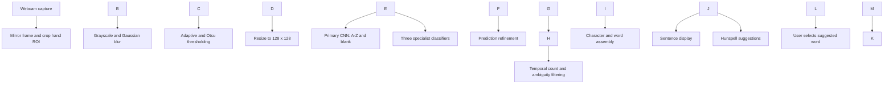

# Sign Language Conversion into Text

A Python desktop application that recognises American Sign Language (ASL) fingerspelling gestures from a standard webcam and converts predictions into written characters, words and sentences. The project combines computer vision, convolutional neural networks (CNNs), temporal prediction filtering and dictionary-based spelling suggestions.

## Overview

The project explores a low-cost assistive communication interface for deaf and hard-of-hearing users. Instead of requiring instrumented gloves or depth cameras, it uses a conventional webcam and a two-stage classification approach to recognise alphabet gestures.

This is an academic research prototype for fingerspelling, not a complete ASL translation system.

## Key features

* Live webcam capture and mirrored video display.
* Hand region-of-interest (ROI) extraction and binary image preprocessing.
* Recognition of 26 alphabet characters and a blank class.
* Two-stage classification using one primary model and three specialist models for visually similar gestures.
* Frame-count filtering before accepting characters, reducing unstable predictions.
* Word and sentence assembly, with blank predictions acting as word boundaries.
* Hunspell-powered spelling suggestions displayed through three selection buttons.
* Tkinter desktop interface displaying live video, processed frames, current character, current word and sentence.

## System architecture



## Technology stack

|Component|Technology|
|-|-|
|Language|Python|
|Computer vision|OpenCV|
|Deep learning|Keras; TensorFlow described in the research manuscript|
|Numerical processing|NumPy|
|Desktop interface|Tkinter|
|Image display|Pillow (PIL / ImageTk)|
|Spelling suggestions|Hunspell (`from hunspell import Hunspell`)|
|Additional imported dependency|PyEnchant (`enchant`)|
|Saved models|Keras JSON architecture and HDF5 (`.h5`) weights|

## Repository structure

```text
sign-language-conversion-int-text/
├── Application.py          # Desktop application and inference pipeline
├── Dataset/                # Dataset directory
├── Models/                 # Model directory
├── .ipynb\_checkpoints/     # Notebook checkpoint directory
└── README.md
```

The application expects the following model files in `Models/`. These names are taken from the model-loading code; verify that every file is present in your local checkout before launching.

|Classifier|Architecture|Weights|
|-|-|-|
|Primary (alphabet + blank)|`model\_new.json`|`model\_new.h5`|
|D / R / U|`model-bw\_dru.json`|`model-bw\_dru.h5`|
|D / I / K / T|`model-bw\_tkdi.json`|`model-bw\_tkdi.h5`|
|M / N / S|`model-bw\_smn.json`|`model-bw\_smn.h5`|

## Dataset and preprocessing

The accompanying research manuscript describes a custom webcam-captured dataset created because the available data did not meet the project's raw-image requirements. It reports approximately 800 training images (the per-class count is not explicit) and 200 test images per sign.

The application processes each webcam frame as follows:

1. Mirror the frame and extract a fixed region of interest.
2. Convert the cropped region to grayscale.
3. Apply a 5 × 5 Gaussian blur to reduce image noise.
4. Apply adaptive Gaussian thresholding followed by Otsu thresholding.
5. Resize the binary image to 128 × 128 pixels.
6. Reshape the input to `(1, 128, 128, 1)` for model inference.

## Deep learning methodology

The research manuscript describes a primary CNN with two convolutional layers (32 filters each), two max-pooling layers, and fully connected layers of 128 and 96 neurons. ReLU activation, dropout of 0.5, Softmax output, cross-entropy loss and Adam optimisation are described for training.

At inference time the application loads four saved Keras models. It evaluates all four on each processed image, sorts the primary class scores and applies selected specialist predictions to refine the result. In the current implementation, the M/N/S specialist only overrides the previous prediction when its highest-scoring class is S.

### Temporal filtering and text generation

The current `Application.py` increments class counters and accepts a prediction when the selected class count exceeds 60 and competing alphabet-class counts pass the ambiguity check (difference greater than 20). Counters are reset after acceptance or an ambiguity rejection; a blank prediction also clears alphabet counters. This is a count-based heuristic, not a measured inference-latency guarantee.

Accepted letters accumulate into a word. An accepted blank commits the word into the sentence, and the GUI offers dictionary suggestions for the current word. Selecting a suggestion appends it to the sentence. The current code also resets the sentence when adding a letter if its length exceeds 16 characters.

## Reported experimental results

The following figures come from the results of the model.

|Configuration|Reported recognition result|
|-|-:|
|Primary classifier only|89.8%|
|Combined two-stage classification|94.0%|

## Getting started

### Prerequisites

* Python 3 with a desktop/Tkinter installation.
* A working webcam accessible as camera index `0` (adjust in `Application.py` if needed).
* A Keras/TensorFlow environment compatible with the saved legacy JSON/HDF5 models.
* An English (US) Hunspell dictionary and a Python binding that supports `Hunspell('en\_US')`.
* Enchant system libraries where required by PyEnchant.
* Git for cloning the repository.

The checked source uses Windows-style paths for model files, so Windows is the simplest starting point. On Linux/macOS, replace those paths with portable paths such as `Path('Models') / 'model\_new.json'` before running.

### 1\. Clone the repository

```bash
git clone https://github.com/SARANYA233/sign-language-conversion-int-text.git
cd sign-language-conversion-int-text
```

### 2\. Create a virtual environment

```bash
python -m venv .venv
```

Windows (PowerShell):

```powershell
.\\.venv\\Scripts\\Activate.ps1
```

Linux/macOS:

```bash
source .venv/bin/activate
```

### 3\. Install dependencies

The repository root does not currently show a pinned requirements file. The following is a starting point based on the application imports, not a tested dependency lockfile:

```bash
python -m pip install numpy opencv-python pillow tensorflow keras pyenchant
```

Install a compatible Hunspell binding separately. One candidate is:

```bash
python -m pip install cyhunspell
```

Hunspell may need native build tools or dictionary packages, depending on the operating system. Check that the chosen binding exposes the correct constructor and suggestion method. Tkinter is normally bundled with desktop Python on Windows; some Linux distributions require a separate `python3-tk` package.

If recent Keras releases cannot deserialize the models, use a compatible legacy Keras/TensorFlow environment or migrate the model files. The original training environment and dependency versions are not documented in the inspected source.

### 4\. Check model files and imports

From the repository root, verify that the eight architecture/weight files listed above exist in `Models/`. Then test the imports and dictionary:

```bash
python -c "import cv2, numpy, tkinter, keras, enchant; from PIL import Image, ImageTk; from hunspell import Hunspell; print(Hunspell('en\_US').suggest('helo'))"
```

### 5\. Start the desktop application

```bash
python Application.py
```

The application loads the saved models, opens the webcam and starts the Tkinter event loop. This runs inference with existing weights; it does not retrain the models.

## How to use

1. Allow access to your webcam if prompted.
2. Position your hand within the camera's recognition region, on the right side of the mirrored frame.
3. Use a plain background and adequate lighting.
4. Hold a fingerspelling gesture long enough for the prediction filter to accept it.
5. Remove your hand from the recognition region to generate a blank prediction and finish the word.
6. Choose a displayed spelling suggestion if appropriate.
7. Close the window to stop the webcam and release resources.

## Limitations and future work

* The system is designed for alphabet fingerspelling rather than continuous ASL grammar or full-sign vocabulary.
* Background clutter, lighting changes and differences between users may affect recognition.
* Dynamic signs and generalisation to unseen signers require further validation.
* Inference speed depends on hardware and model-loading compatibility; no measured FPS is claimed.
* The current implementation is a local desktop prototype, not a cloud-hosted or production web service.
* Future improvements include portable configuration, pinned dependencies, reproducible training/evaluation scripts, improved segmentation, signer-independent testing, and web/mobile interfaces.

## 

Related tools: [OpenCV](https://opencv.org/), [Keras](https://keras.io/), [TensorFlow](https://www.tensorflow.org/) and [Hunspell](https://hunspell.github.io/).

## 

